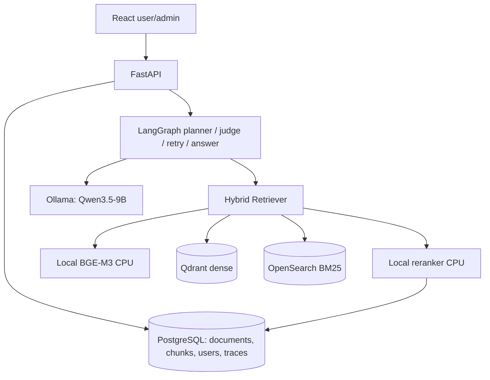

# AI-Agent Clip — Corporate Intelligence Lab

**Offline-capable, local-first agentic RAG search for corporate regulations, orders and product licensing documents.** Hackathon MVP. Python **3.12 only**. User interface in Russian.

> **DEMO ONLY — NO AUTHENTICATION.** API includes unauthenticated admin operations and demo-user IDs. Bind the service to `127.0.0.1`; do not expose it to a corporate network or internet. Access control and security review are mandatory before real deployment.

## What works in MVP

- Upload and index UTF-8 TXT/MD, text PDF and DOCX; document lineage and immutable revisions, active/inactive switch and restore.
- Paragraph/page-aware **parent context + search child** with exact child offsets for highlighting and traceable citation.
- Local **BGE-M3** 1024-d embeddings → **Qdrant dense**; OpenSearch **BM25** sparse → **RRF** fusion → optional local **BGE-reranker-v2-m3**.
- Bounded **LangGraph** agent: query planner → hybrid retrieval → evidence-coverage judge → optional retry → local Qwen answer with numbered citations.
- Handles multi-document questions and acknowledges unresolvable conflicts; does **not** auto-assume that every later order supersedes an earlier order.
- Postgres conversation history scoped by (demo user, session), traces and token counts, feedback, top questions, failures, latency.
- React app: user search with highlighted source snippets; admin document registry, uploads, soft-deactivation, analytics and recent traces.
- Verified-memory table and admin approval endpoint are a **future collective-memory seam**. These records are **not yet read into responses** to avoid unsafe cross-user fact propagation.

## Architecture at a glance



For details see [Architecture](docs/ARCHITECTURE.md), [ADRs](docs/adr), [Evaluation](docs/EVALUATION.md), [Memory](docs/MEMORY.md), [Roadmap](docs/ROADMAP.md) and [CodeX Tasks](docs/codex/TASKS.md).

## Hardware assumptions

Reference machine: Ryzen 7 9700X, 64 GB RAM, RTX 5070 Ti **16 GB VRAM**. We serve **Qwen3.5:9b in Ollama on GPU**, and embeddings/reranker **on CPU** by default. This intentionally avoids GPU contention; measure latency and test CUDA model placement later. For a small hackathon corpus, CPU indexing is acceptable. Qwen3.5 model variants and licenses: https://ollama.com/library/qwen3.5:9b ; BGE-M3: https://huggingface.co/BAAI/bge-m3 ; reranker: https://huggingface.co/BAAI/bge-reranker-v2-m3 . Pin exact model revisions after the first successful local download.

## Prerequisites

- Python 3.12 (not 3.11 or 3.13). Use `py -3.12` on Windows or `python3.12` in WSL.
- Node.js 20+ and npm.
- Running **existing** PostgreSQL, Qdrant, OpenSearch services on localhost.
- Ollama installed and responding at `http://localhost:11434` (adjust `OLLAMA_URL` if Ollama runs on Windows host and backend in WSL).
- First install needs internet for packages and models; after downloading, the **runtime does not call hosted LLM APIs**.

## Quick start in WSL

```bash
cd agent-clip-hackathon
cp .env.example .env
# Edit .env: POSTGRES_DSN credentials and reachable ports. Keep .env out of git.
python3.12 -m venv .venv
source .venv/bin/activate
python -m pip install -U pip
pip install -e '.[dev]'

# PostgreSQL database only; requires CREATEDB rights for the configured role.
python scripts/create_database.py

# Start Ollama separately, install model and verify it is reachable:
ollama pull qwen3.5:9b
curl http://localhost:11434/api/tags

# Start backend: creates tables in new DB. Qdrant collection and
# OpenSearch index are created automatically on first successful upload.
uvicorn clip_agent.main:app --host 127.0.0.1 --port 8000
```

In another terminal:

```bash
cd agent-clip-hackathon/frontend
npm install
npm run dev
# Open http://localhost:5173
```

If the PostgreSQL role lacks CREATEDB permission, create DB as a privileged administrator, e.g. `CREATE DATABASE clip_agent_2026 OWNER rag;` and then skip `scripts/create_database.py`. Never touch the old `rag` database. The new vector collection is `clip_agent_dense_v1`; new sparse index is `clip_agent_sparse_v1`. Their names are separate from previous projects.

### Cold-start behaviour

First upload downloads and loads embedding and reranking weights (reranker is loaded on first query). Initial latency can be much higher. Pre-download by indexing the synthetic examples and asking a practice question **before recording**. With model downloads cached, runtime calls remain local. Loading all models may use substantial CPU RAM, which the reference machine has.

### Synthetic example corpus

After the API starts:

```bash
python scripts/seed_demo.py
```

This indexes **four clearly marked synthetic documents** from `examples/`. Run once (re-running creates duplicates). Then test:

1. «Какие пени применяются за просрочку предоплаты и почему в документах указаны разные ставки?»
2. «Кто согласовывает агентский договор и в каком порядке?»
3. «Какие условия лицензирования продукта Альфа и какие согласования требуются?»

Actual organizer data will be made available later; do not claim synthetic corpus is the real one.

## Config / isolation

The `.env.example` uses distinct project namespaces for all three storages and avoids checking in credentials. Storage keys are **logical** and platform-independent: `documents/<document_uuid>/<revision_uuid>/source.ext`. The adapter resolves them relative to `STORAGE_ROOT`. File names are metadata, not storage paths.

| Env | Default | Notes |
|---|---|---|
| POSTGRES_DSN | `.../clip_agent_2026` | New database; change password |
| QDRANT_COLLECTION | `clip_agent_dense_v1` | New collection; vectors=1024 |
| OPENSEARCH_INDEX | `clip_agent_sparse_v1` | New BM25 index |
| OLLAMA_MODEL | `qwen3.5:9b` | Quantized local LLM |
| EMBEDDING_MODEL | `BAAI/bge-m3` | 1024-d vector model |
| RERANK_ENABLED | `true` | Set `false` for latency comparison |
| AGENT_JUDGE_ENABLED | `true` | LLM evidence sufficiency |
| AGENT_MAX_RETRIES | `1` | Bound search loops |
| MULTIQUERY_VARIANTS | `3` | Includes original question |

Never change embedding model/dimension on a populated index without reindexing into a **new** collection. Likewise, do not silently reuse old indexes.

## Example API

```bash
curl http://127.0.0.1:8000/healthz
curl -X POST http://127.0.0.1:8000/api/v1/ask \
 -H 'Content-Type: application/json' \
 -d '{"question":"Что сказано о штрафных пенях?","user_id":"employee-a","session_id":"demo-1"}'
curl http://127.0.0.1:8000/api/v1/admin/analytics
```

Full OpenAPI spec: http://127.0.0.1:8000/docs . A demo user ID is not an identity control.

## Tests and quality baseline

```bash
pytest -q
ruff check backend tests
cd frontend && npm run build
```

The included unit tests exercise pure chunking, source offsets, RRF, query planning and JSON parsing **without downloading any models**. The integration tests with real Ollama/Qdrant/OpenSearch/Postgres must be run locally; [Evaluation protocol](docs/EVALUATION.md). No benchmark results or successful end-to-end inference are claimed until observed.

## Demonstration and submission

See [3-minute uncut demo script](docs/DEMO.md) and [one-page product description draft](docs/PRODUCT_ONE_PAGE.md). Before submission, record **one continuous take**, link the actual Git repository with commit history and report exact `git rev-parse HEAD` hash. List reused components and local model names.

## Limitations / scope

- No OCR, tables or layout reconstruction. Scanned PDFs fail safely.
- DOCX/MD/TXT have **no trustworthy page number**; UI displays “not determined”. Paragraph IDs refer to extractor output, not visual formatting.
- No genuine authentication, authorization, corporate SSO, ACL enforcement, encryption-at-rest, audit security or legal validity inference.
- A quotation citation is a **navigation hint**, not a formal forensic pinpoint reference.
- LLM judge and citation checker do **not** prove factual correctness. Feedback is not automatically used for training.
- No concurrent upload workers, queue, checkpoint recovery, migrations or automatic reconciliation of dual search indexes yet.
- No email/chat ingestion (not provided by organizer).

## Documentation / provenance

Hackathon organizer Q&A mentions **no guaranteed golden dataset** despite conflicting early statements. Detailed specification expected **26 Nov 2026**. Decisions and assumptions are documented in [Q&A notes](docs/HACKATHON_ASSUMPTIONS.md). All code and synthetic fixtures in this repository are new hackathon scaffolding; disclose any external/reused code in final product description.

License: [MIT](LICENSE). Model weights and dependencies retain their respective licenses.

## Start tracking history in Git

```bash
git init
git add .
git commit -m "feat: local-first agentic RAG hackathon baseline"
# Then create your GitHub repository and add your own remote URL:
# git remote add origin <YOUR_GITHUB_REPOSITORY_URL>
# git push -u origin main
```

If your Git default branch is not `main`, rename it with `git branch -M main` before pushing. The final submission needs the real `git rev-parse HEAD` value **after** all changes are frozen. No repository has been published or committed for you.

**Reproducibility follow-up:** this scaffold deliberately includes version *ranges*, not a lockfile: once the full dependency set runs on Python 3.12 in WSL, commit a tested lock / pinned requirements and the frontend `package-lock.json`, along with model exact revisions and an environment snapshot.
