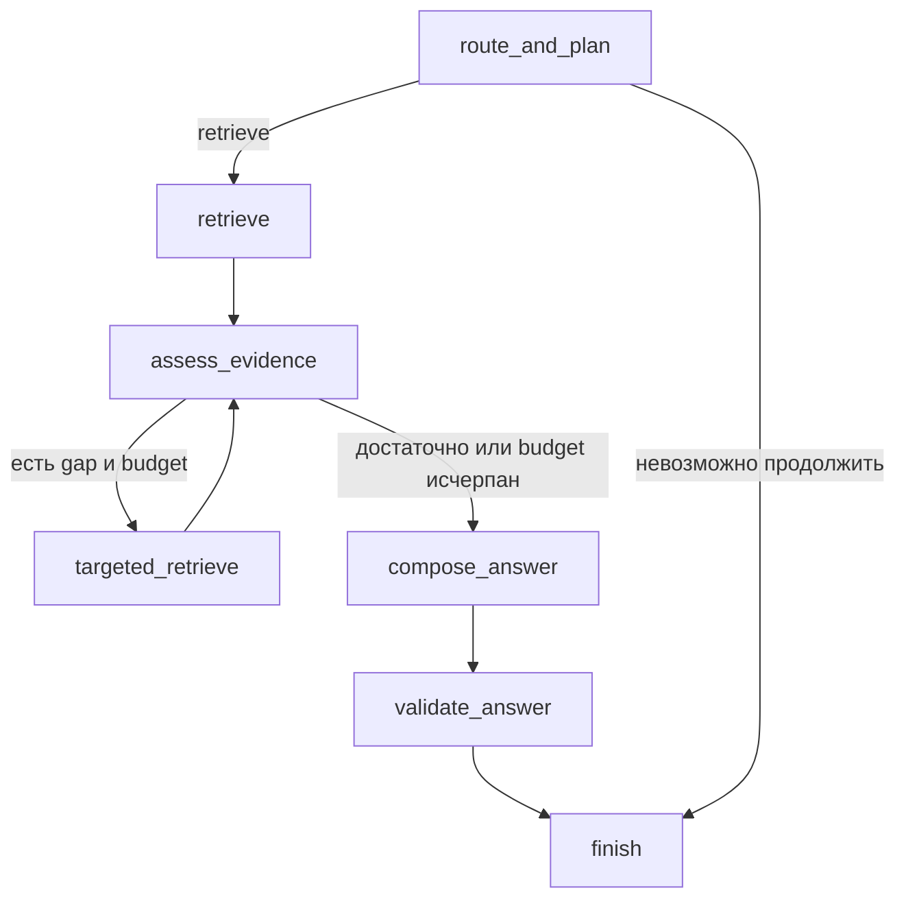

# CLIP-006 — Bounded LangGraph Agent & Evidence Validation

Дата: 2026-11-23. Исходная версия: `ddb90f5` (CLIP-005). Все модели,
embeddings и проверки выполнялись локально. Reranker в обоих контрольных прогонах
выключен.

## Решение

Реализован ограниченный LangGraph-режим за флагом `AGENT_ENABLED`. Он улучшил
корректность отказов и снизил число запрещённых утверждений, но не включён по
умолчанию: автоматическая required-facts метрика немного снизилась, а средняя задержка
выросла на 3,52 секунды. Baseline остаётся рабочим и используется при выключенном
флаге или исключении agent runtime.

## Граф и условные переходы

Это фактические `StateGraph.add_conditional_edges`, а не последовательный вызов
функций. Цикл возможен только между `assess_evidence` и `targeted_retrieve`;
`AGENT_MAX_RETRIES`, `AGENT_MAX_SEARCH_CALLS` и LangGraph `recursion_limit=20`
не позволяют ему стать бесконечным.

Простой вопрос получает один аспект и исходный search query без LLM planner. Для
сложного вопроса planner возвращает JSON с максимум тремя аспектами и двумя запросами.
Исходный вопрос всегда остаётся первым запросом. Некорректный JSON даёт
`planner_fallback` на исходный вопрос.

## Состояние

`AgentState` содержит:

- request/question, `user_id`, `session_id`;
- plan, search queries и уже выполненные queries;
- evidence, gaps и decisions;
- trajectory с node, decision, latency и деталями перехода;
- search/LLM/retry/step counters;
- prompt/completion tokens;
- answer, validation, refusal reason и errors.

Персистентный LangGraph checkpointer намеренно не используется: долгосрочная и
коллективная память не входят в CLIP-006. Изоляция обеспечена новым state на каждый
вызов; идентификаторы сохраняются в PostgreSQL `search_traces.details`.

## Evidence assessment и validation

Оценка выполняется отдельно для каждого аспекта и может ссылаться только на реальные
`chunk_id`. Ссылки модели на неизвестные source IDs отбрасываются. LLM assessment не
становится источником корпоративного факта.

Agent prompt и детерминированная проверка запрещают:

- перенос срока лицензии на техническую поддержку;
- вывод о запрете/наличии автопродления из отсутствия условия;
- подмену даты вступления в силу датой издания;
- приоритет документов только по датам;
- отрицательный факт из отсутствия документа в выдаче.

Для явно указанного в source пробела по сроку поддержки и автопродлению формируется
детерминированный grounded отказ. Temporal evidence-gate сохраняется. Citation repair
использует существующий prompt и выполняется только при свободных retry/LLM budgets.
При неподтверждённом draft результат заменяется явным отказом, а не выдаётся как факт.

## Конфигурация

| Переменная | Default | Назначение |
|---|---:|---|
| `AGENT_ENABLED` | `false` | baseline/agent switch |
| `AGENT_MAX_SEARCH_CALLS` | 3 | верхняя граница hybrid retrieval calls |
| `AGENT_MAX_RETRIES` | 1 | общий budget targeted retrieval/citation repair |
| `AGENT_MAX_LLM_CALLS` | 4 | planner, assessor, compose, validate/repair |

Закреплён `langgraph==1.2.24`; пакет поддерживает Python 3.12. Qwen, BGE-M3,
Qdrant, OpenSearch, RRF, optional reranker, ingestion, temporal gate, PostgreSQL и
React API не заменялись.

## Воспроизводимость

Evaluation format повышен до `clip-evaluation-run/v2`. Каждый run хранит HEAD и
SHA-256 фактического tracked/untracked source tree, dirty flag и porcelain status.
Это устраняет ситуацию, когда незакоммиченный код идентифицировался только старым
Git SHA.

Финальная пара:

- A: `corporate_v2-20261123T183341+0300-ddb90f57-024cd88c`;
- B: `corporate_v2-20261123T183539+0300-ddb90f57-024cd88c`;
- source tree SHA-256:
  `024cd88c6172f21c5dea473ee3ae79b554635f8ca41fb05510beebfc9a5ea11e`;
- dataset SHA-256:
  `6f77bfe0385f4bde4f4e2d17679d61e55b7001335aef493f6eb6d3a27693bf7b`;
- corpus SHA-256:
  `d9603fc4ffb7ba502485889cea44eaaef53717d6429aafd9a4becf81839ca907`;
- 26 документов, 36 вопросов, 36/36 completed, 0 errors в обоих режимах;
- Qwen `qwen3.5:9b`, think=false, temperature=0, num_predict=512;
- BGE-M3 CPU, dense/sparse top-50, RRF k=60, candidates=24, parents=8.

## A/B результаты

| Метрика | A: baseline | B: agent | Delta |
|---|---:|---:|---:|
| Recall@1 | 0.8287 | 0.8287 | 0 |
| Recall@3 | 0.9769 | 0.9769 | 0 |
| Recall@5 / @8 | 1.0000 | 1.0000 | 0 |
| MRR | 0.9537 | 0.9537 | 0 |
| nDCG@5 | 0.9682 | 0.9682 | 0 |
| Required facts pass | 0.8621 | 0.8276 | -0.0345 |
| Forbidden claims clear | 0.8611 | 0.9722 | +0.1111 |
| Citation IDs valid | 1.0000 | 1.0000 | 0 |
| Automatic abstention accuracy | 0.4286 | 0.8571 | +0.4285 |
| Latency mean, ms | 2672.8 | 6192.4 | +3519.7 |
| Latency median, ms | 2370.0 | 5644.0 | +3274.0 |
| Latency p95, ms | 4951.0 | 11518.0 | +6567.0 |
| Input tokens total | 42 485 | 104 587 | +62 102 |
| Output tokens total | 4 521 | 14 207 | +9 686 |
| Search calls total / mean | 36 / 1.0 | 48 / 1.3333 | +12 / +0.3333 |
| LLM calls total / mean | 36 / 1.0 | 90 / 2.5 | +54 / +1.5 |
| Agent steps mean | not applicable | 6.1111 | — |

Retrieval не изменился, поскольку top-8 baseline уже насыщен. Улучшение относится к
answer validation/abstention, а не к поисковому ранжированию.

Required-facts failures B: CV2-012, 020, 030, 031, 032. В четырёх ответах факты
семантически присутствуют, но узкая lexical/citation-locality проверка не принимает
формы вроде «процентов от оклада» или ссылку в соседнем предложении. CV2-030 завершился
слишком консервативным отказом после citation validation. Это реальная оставшаяся
регрессия. Gold и regex не менялись.

Forbidden-claim failure B: CV2-005. Его следует рассматривать отдельно при следующем
эксперименте; общий показатель улучшился на четыре кейса.

## Содержательная проверка abstention

По versioned source-текстам вручную сверены все семь сценариев:

| Case | Result | Основание |
|---|---|---|
| CV2-008 | correct | order 204 прямо не устанавливает пени |
| CV2-013 | correct | передача отчёта указана, срок в днях отсутствует |
| CV2-022 | correct | срок поддержки прямо не определён; 12 месяцев — лицензия |
| CV2-023 | correct | автопродление не определено; это не запрет |
| CV2-026 | correct | срок проверки в рабочих днях не установлен |
| CV2-029 | correct | новая редакция с 1 апреля; действие старой на 15 марта не доказано |
| CV2-034 | correct | порядок оплаты больничного не определён |

Ручная содержательная проверка: 7/7. Automatic detector: 6/7, потому что CV2-026
использует корректную формулировку «срок ... не установлен», не покрытую текущим regex.
Это подтверждает, что lexical detector остаётся вспомогательным и не доказывает
семантическое качество.

## Проверки и ограничения

Unit-тесты покрывают fast/multi routes, gap, targeted retrieval, budgets, malformed
planner JSON, unsupported claims, abstention, bounded cycle, trace persistence payload,
user/session isolation, citation repair и fallback на baseline.

Финальные проверки:

- `.\.venv\Scripts\python.exe -m pytest -q`: 36 passed, 2 существующих
  FastAPI `on_event` deprecation warnings;
- `.\.venv\Scripts\ruff.exe check backend tests scripts`: passed;
- `.\.venv\Scripts\python.exe -m pip check`: no broken requirements;
- `npm run build`: passed, Vite 6.4.6, 29 modules;
- `npm audit --omit=dev`: 0 vulnerabilities;
- corporate_v2 A/B: 36/36 completed и 0 errors в каждом run.

Ограничения:

- agent увеличивает число LLM-вызовов, tokens и latency;
- JSON assessment зависит от локальной модели и имеет controlled fallback;
- синтаксическая citation validation не является entailment;
- source gap guards ограничены явно проверяемыми формулировками;
- production ACL/auth, OCR, таблицы и shared memory не добавлялись;
- результаты относятся к синтетическому corporate_v2, не к документам заказчика.

Решение: оставить `AGENT_ENABLED=false`. Эксперимент подтверждает улучшение отказов,
но рост latency и regression required-facts пока не позволяют включить агент по
умолчанию.
